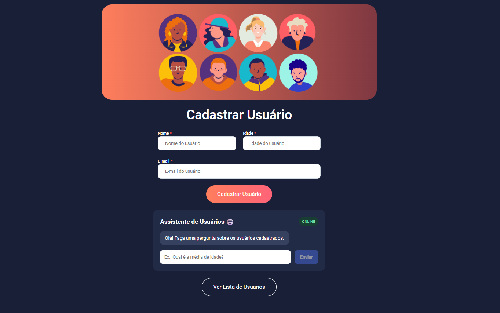
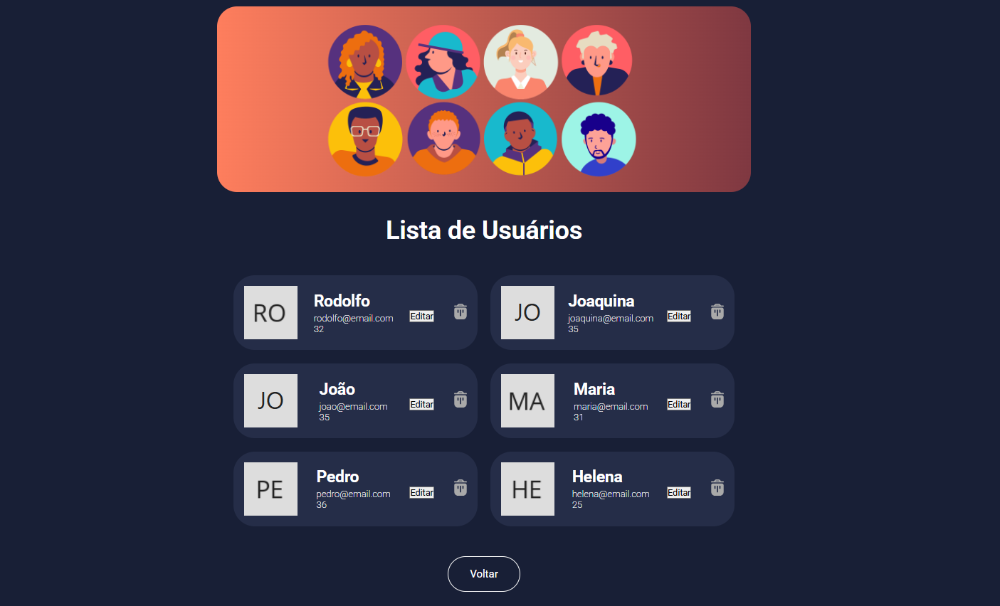
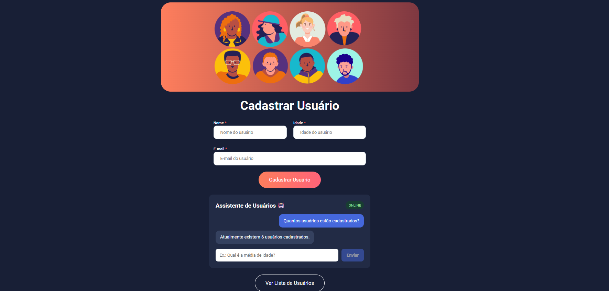

# User Registration Project

A full-stack web application for user registration and management, built with **React, Node.js, Express, Prisma ORM, and MongoDB**.

The application provides a responsive interface where users can create, view, update, and delete registrations. It also features an interactive user assistant that answers questions using real database information.

The frontend communicates with a REST API connected to a MongoDB database.

## Live Demo

- **Frontend:** [View Live Application](https://user-registration-project-phi.vercel.app/)
- **Backend API:** [Access API](https://user-registration-api-lkzu.onrender.com/)
- **Repository:** [GitHub Repository](https://github.com/LehiSaid/user-registration-project)

> **Note:** The backend is hosted on Render's free tier. After a period of inactivity, the service may go to sleep. The first request can take a little longer while the server starts.
>

## Screenshots

### Home Page


### Users List


### User Assistant


## Technologies

### Frontend
- React
- JavaScript
- Vite
- React Router
- Axios
- Styled Components
- CSS

### Backend
- Node.js
- Express.js
- Prisma ORM
- MongoDB
- OpenAI SDK
- REST API

### Deployment
- Vercel — Frontend hosting
- Render — Backend hosting
- MongoDB Atlas — Database hosting

## Features

### User Management

- Create new user registrations.
- Display registered users.
- Edit existing user information.
- Delete users.
- Validate form fields before submission.
- Display success and error feedback messages.
- Show loading states while retrieving user data.
- Handle API connection errors with a retry option.
- Store user information in MongoDB.

### User Assistant

The application includes an interactive assistant that answers questions about registered users using real database information.

The backend retrieves user records from MongoDB, calculates statistics, and provides the relevant information to the assistant.

Currently, the assistant supports five types of queries:

- Total number of registered users.
- Average age of registered users.
- Number of users over 18.
- Identification of the oldest user.
- Identification of the youngest user.

**Demo Mode:**
Uses JavaScript-based rules to interpret questions and generate responses without requiring an OpenAI API key.

**AI Mode:**
Integrates with the OpenAI API to interpret user questions and generate natural language responses based on statistics retrieved from the database.

## Project Structure

```text
user-registration-project/
│
├── backend/
│   ├── prisma/
│   │   └── schema.prisma
│   ├── server.js
│   └── package.json
│
├── frontend/
│   ├── public/
│   ├── src/
│   │   ├── components/
│   │   ├── pages/
│   │   │   ├── Home/
│   │   │   └── ListUsers/
│   │   ├── services/
│   │   └── styles/
│   └── package.json
│
├── .gitignore
└── README.md
```

## API Endpoints

The backend provides the following REST API endpoints:

| Method | Endpoint | Description |
|---|---|---|
| GET | `/usuarios` | Retrieve all users |
| POST | `/usuarios` | Create a new user |
| PUT | `/usuarios/:id` | Update an existing user |
| DELETE | `/usuarios/:id` | Delete a user |
| POST | `/assistente/usuarios` | Ask the user assistant a question |

## Getting Started

### Prerequisites

Make sure you have the following installed:

- Node.js
- npm
- A MongoDB database

### 1. Clone the repository

```bash
git clone https://github.com/LehiSaid/user-registration-project.git

cd user-registration-project
```

### 2. Set up the backend

Navigate to the backend folder:

```bash
cd backend
npm install
```

Create a `.env` file inside the `backend` folder:

```env
DATABASE_URL="your_mongodb_connection_string"
AI_DEMO_MODE=true
```

For Demo Mode, no OpenAI API key is required.

To use AI Mode, configure the following environment variables instead:

```env
DATABASE_URL="your_mongodb_connection_string"
AI_DEMO_MODE=false
OPENAI_API_KEY="your_openai_api_key"
```

Generate the Prisma Client:

```bash
npx prisma generate
```

Start the backend:

```bash
npm start
```

### 3. Set up the frontend

Open another terminal and navigate to the frontend folder:

```bash
cd frontend
npm install
```

Create a `.env` file inside the frontend folder:

```env
VITE_API_URL=http://localhost:3000
```

Start the development server:

```bash
npm run dev
```

The frontend will usually be available at:

```text
http://localhost:5173
```

> Make sure the backend is running before using the frontend application.

## What I Learned

During this project, I practiced and improved my skills in:

- Building full-stack applications with React and Node.js.
- Developing REST APIs with Express.
- Managing database operations with Prisma ORM and MongoDB.
- Handling asynchronous JavaScript operations using Promises and async/await.
- Integrating frontend and backend services using Axios.
- Implementing an assistant that processes real database information.
- Integrating an external AI API into a backend application.
- Managing environment variables and application configurations.
- Handling errors and providing feedback to users.

## Future Improvements

- Improve the assistant's ability to understand different types of questions.
- Expand the available database statistics.
- Improve the user interface and assistant experience.
- Add more advanced AI-powered features.

---

Developed by **Lehi da Silva Said**.

[GitHub](https://github.com/LehiSaid) | [LinkedIn](https://www.linkedin.com/in/lehisaid/)
